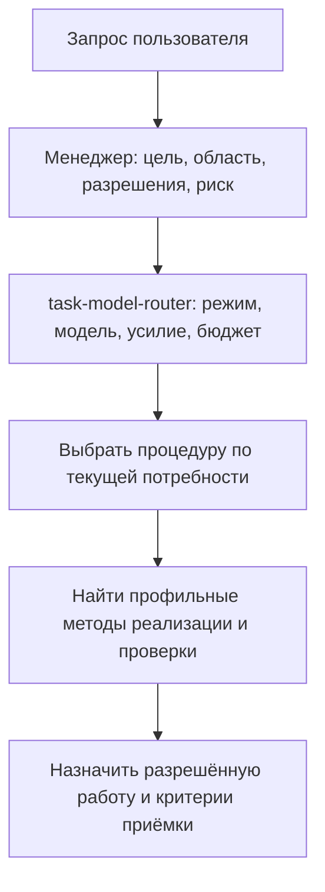
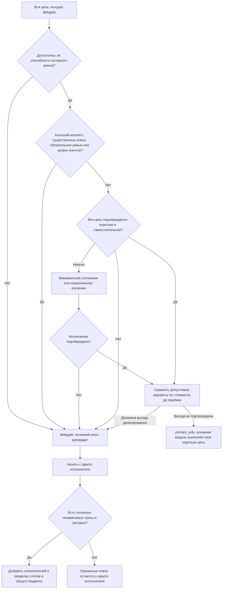
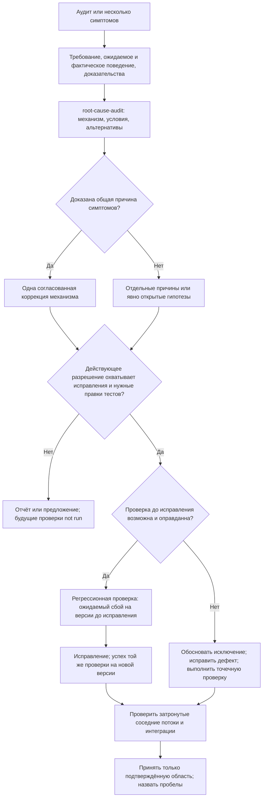
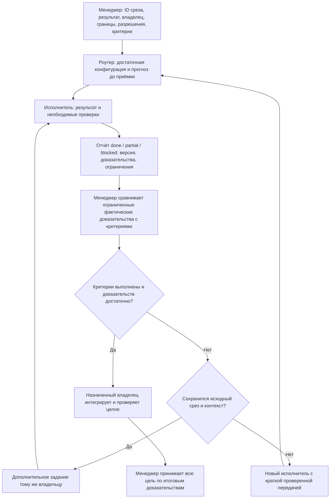
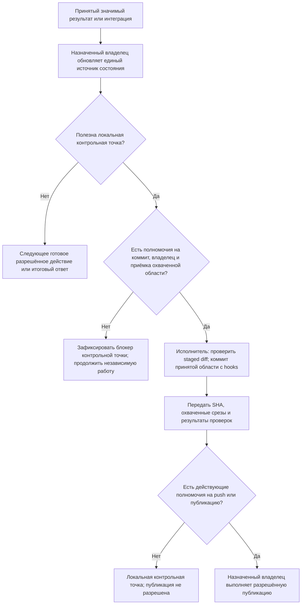

# Менеджер субагентов: наглядное руководство

**Менеджер субагентов** (`subagent-manager`) работает как Agent Orchestrator. Основной агент определяет маршрут, назначает владельцев работы и принимает доказательства. В режиме `delegate` исполнители исследуют свои области, создают результат, проверяют его и выполняют интеграцию. Ответственность за всю цель остаётся у менеджера.

Это пояснение к навыкам, а не новый источник обязательных правил. При расхождении действуют [subagent-manager](../skills/subagent-manager/SKILL.md) и [task-model-router](../skills/task-model-router/SKILL.md). Пять схем Mermaid показывают порядок работы. Они не гарантируют автоматический вызов навыков или экономию. GitHub отображает блоки `mermaid` как диаграммы.

**Навык — процедура, а не отдельный агент.** Выбор навыка не запускает специалиста. Менеджер загружает только выбранный навык и нужные разделы. Второго менеджера и обязательной цепочки специалистов нет.

## 1. Маршрут зависит от цели и результата

Перед полным исследованием менеджер фиксирует цель, тип результата, конечную область и версию, разрешения, риск, нужные доказательства и режим выполнения. Для узкого вопроса достаточно соответствующей проверки. Комплексный аудит нужен для объявленной связанной области.

| Текущая потребность | Навык или метод и его граница |
| --- | --- |
| Координация и приёмка | `subagent-manager`: основной агент остаётся единственным менеджером. |
| Режим, модель, усилие и бюджет | `task-model-router`: оценка всей цели перед выполнением. |
| Сложный план, ревью плана или возобновление | [plan-agent-work](../skills/plan-agent-work/SKILL.md). |
| Комплексный аудит объявленной области | [comprehensive-audit](../skills/comprehensive-audit/SKILL.md): покрытие по типу результата и риску. |
| Диагноз, связанные симптомы или причина перед исправлением | [root-cause-audit](../skills/root-cause-audit/SKILL.md): причины не объединяют без доказательств. |
| Нетривиальный выбор внутри разрешённой работы | [autonomous-decision-agent](../skills/autonomous-decision-agent/SKILL.md): ограниченный совет с правом чтения через текущего менеджера. Не заменяет согласие пользователя. |
| Аудит инструкций или их изменений | [agent-instructions-audit](../skills/agent-instructions-audit/SKILL.md): правка инструкций требует одобрения конкретного изменения. |
| Крупная работа завершена или запрошен разбор расхода | [task-token-retrospective](../skills/task-token-retrospective/SKILL.md): выводы по доступным данным без выдуманных счётчиков. |
| Реализация и проверка результата | Доступные профильные навыки. Для программного кода — навык реализации и `code-verification`; для других результатов — соответствующие методы проверки. |

Таблица охватывает восемь навыков набора. Навыки реализации и `code-verification` находятся во внешнем каталоге среды; их пути нельзя угадывать. Загружают только нужную процедуру текущего этапа. Недоступную зависимость отмечают как ограничение. Отсутствие обязательного роутера останавливает выбор режима и зависимые действия проекта.

Два независимых решения сохраняются на всём маршруте:

| Решение | Что оно определяет |
| --- | --- |
| Полномочия: `PLAN ONLY`, `PLAN+EXECUTE`, аудит, ревью, возобновление | Какие действия разрешены. `PLAN ONLY` допускает запись разрешённых файлов плана, но не реализацию и её проверки. Будущие проверки имеют статус `not run`. При возобновлении восстанавливают прежние полномочия. |
| Выполнение: `delegate` или `primary_only` | Кто выполняет разрешённую работу. План может составлять назначенный исполнитель. Метка «аудит» или «возобновление» сама по себе не выбирает исполнителя. |

Для сохранённой дорожной карты используется один пакет: краткий индекс с состояниями и ссылками, затем отдельный файл каждого определённого шага. Число шагов зависит от работы. Для продолжения читают индекс и только нужные шаги.

Источники: [маршрутизация менеджера](../skills/subagent-manager/SKILL.md#route-the-current-goal), [режимы плана](../skills/plan-agent-work/SKILL.md#select-the-mode-first), [пакет дорожной карты](../skills/plan-agent-work/SKILL.md#choose-the-smallest-useful-route).

## 2. Кто выполняет работу

Исходный режим — `delegate`. Исключение оценивают для **всей текущей цели**, до полного исследования. Способности и ожидаемый контекст проверяют раньше стоимости.

Обычное чтение, небольшая локальная правка и точечная проверка могут составлять одну короткую цель. Длинная связанная цепочка требует делегирования, даже если её выполняет один исполнитель. Маленький оставшийся шаг большой цели не создаёт исключения. Неопределённость не разрешает основному агенту начать выполнение.

Срез — часть работы с одним результатом и критериями приёмки. Количество файлов, команд или профессиональных ролей не определяет количество агентов. Независимость включает общие интерфейсы, состояние и ресурсы. Отдельный агент для классификации не нужен.

Если обязательный исполнитель недоступен из-за инструментов, слотов, разрешений или строгого бюджета, зависимые действия останавливают. Менеджер не подменяет исполнителя собой. Независимую разрешённую работу продолжают в пределах выбранной роли. Неизвестную стоимость не считают нулевой.

Источники: [выбор режима](../skills/subagent-manager/SKILL.md#choose-the-execution-mode), [порядок оценки в роутере](../skills/task-model-router/SKILL.md#select-who-does-the-work), [назначение исполнителей](../skills/subagent-manager/SKILL.md#give-assignments-in-delegate-mode).

## 3. От аудита и нескольких симптомов к исправлению

Аудит оценивает конечную объявленную область по требованиям и риску. Он выбирает применимые проверки: поведение, связи, регрессии, UI/UX, структуру, границы и взаимодействия. Для документов, данных и графики используются проверки соответствующего результата. Полный программный набор проверок не нужен каждому артефакту.

Аудит и диагноз сами по себе не разрешают исправления, новые тесты или наблюдение, которое меняет систему. Уже действующее разрешение на эти действия сохраняется; повторное согласование не нужно. В `PLAN ONLY` показанные проверки остаются будущими критериями. Запускать их нельзя. Для узкого исправления достаточно причинного анализа и [процедуры приёмки исправлений](../skills/comprehensive-audit/references/remediation.md); новый комплексный аудит и матрица покрытия не обязательны.

Существующий тест используют повторно, если он обнаруживает ошибку. Для непрограммного результата подходит воспроизводимое сравнение до и после. Недоступная исходная версия, невозможность безопасного воспроизведения или тривиальная правка требуют обоснованного исключения. Исторический сбой нельзя выдумывать. Временная мера должна назвать незакрытую причину и последующую проверку; исчезновение симптома не доказывает устранение причины.

Проверки соседних потоков выбирают по изменённому механизму, контрактам, общему состоянию и риску. Для UI/UX нужны наблюдения готового изображения или работающего интерфейса. Зелёные тесты не закрывают пробел в визуальной проверке. Для комплексного аудита матрица покрытия сохраняет выполненные проверки, исключения и непроверенные области. Завершённый аудит не означает принятую реализацию или выпуск.

Источники: [комплексный аудит](../skills/comprehensive-audit/SKILL.md), [причинный аудит](../skills/root-cause-audit/SKILL.md), [регрессии и границы исправления](../skills/comprehensive-audit/references/remediation.md#establish-regression-evidence).

## 4. Владение, доказательства и приёмка

У каждого файла, общего интерфейса, ресурса и проверки есть один владелец. Назначение содержит точные пути и нужные разделы источников, зависимости, язык результата и отчёта, критерии и способ передачи. Разные файлы не доказывают независимость баз данных, браузера или общего индекса Git.

Отчёт содержит фактические результаты проверок, команды и коды завершения, версии входов и интерфейсов, невыполненные проверки, до трёх ссылок на доказательства и оставшийся риск. Недоступные счётчики отмечают `unknown` или `lower-bound`. Заявления исполнителя «готово» недостаточно. Нельзя принимать доказательства от смешанных версий.

Менеджер может проверить конкретный пробел, противоречие или изменённый вход в ограниченной области. Он не повторяет полное исследование исполнителя и неизменные проверки. После локальной правки повторяют только затронутые проверки или проверку названного пробела. Независимое ревью требуется при существенном риске, спорном решении или прямом запросе; оно не заменяется самопроверкой.

Тот же исполнитель продолжает только свой исходный срез с прежним контрактом, ролью, контекстом и полномочиями. Версии внутри этого среза могут меняться. Новая область, самостоятельный результат или независимое ревью требуют нового исполнителя. Связанные диагноз, исправление и проверка могут остаться у одного владельца, если исходное назначение охватывает их.

Источники: [содержание назначения](../skills/subagent-manager/SKILL.md#give-assignments-in-delegate-mode), [общие ресурсы](../skills/subagent-manager/SKILL.md#control-shared-work), [продолжение исходного среза](../skills/subagent-manager/SKILL.md#reuse-within-the-original-slice), [приёмка](../skills/subagent-manager/SKILL.md#accept-and-integrate).

## 5. Состояние, контрольная точка и публикация

В режиме `delegate` файлы состояния, дорожную карту и Git изменяют назначенные исполнители. Менеджер принимает результат и координирует работу. Если подходящего владельца нет, он сообщает предлагаемый статус в разговоре. Создавать агента только для учёта не нужно.

Один источник состояния хранит решения, владельцев, принятые результаты, доказательства, блокеры и следующее разрешённое действие. Для дорожной карты доказательства записывают в файл шага, затем владелец статуса обновляет индекс. При возобновлении проверяют изменённые входы и фактическое состояние инструментов. Текстовая запись не восстанавливает сессию или незавершённый вызов API.

Менеджер выбирает полезную границу контрольной точки, а не коммит после каждой команды. Он разрешает выполнение запланированного коммита только после приёмки его области и проверок. Полномочия на локальный коммит не дают полномочий на push. Действующее разрешение повторно не запрашивают. При коммите сохраняют чужие изменения и hooks; индекс Git имеет одного владельца. После сбоя проверяют фактические HEAD и статус перед повтором.

Источники: [выбор контрольных точек](../skills/subagent-manager/SKILL.md#choose-local-checkpoints), [локальные коммиты](../skills/plan-agent-work/references/execution.md#local-milestone-commits), [единое состояние](../skills/plan-agent-work/references/execution.md#maintain-one-state-source), [возобновление](../skills/plan-agent-work/references/execution.md#resume-checkpoint).

## Если проверка не прошла или прогноз изменился

После двух неудачных исправлений одного критерия прекращают слепые повторы. Сохраняют ожидаемый и фактический результаты, случай, артефакты и сведения о прошлых попытках. Устанавливают причину: дефект результата, неясный контракт, сбой проверки или ограничение среды. Сбой инструмента сам по себе не доказывает слабость модели.

Перед существенным повышением усилия или модели применяют роутер. После провала приёмки или превышения прогноза пересматривают оставшуюся работу и конфигурацию до новых запусков. Пересмотр прогноза не расширяет полномочия и не разрешает неограниченный рост ресурсов. Если инструмент не поддерживает нужную смену конфигурации для продолжения, новому исполнителю передают тот же срез и проверенную краткую передачу.

**Строгий лимит пользователя обязателен для всей команды.** До зависимых платных запусков нужны достаточные учёт и контроль. Если их нет, запуск останавливают до подтверждения соблюдения лимита; увеличение лимита не заменяет контроль. Если достаточная попытка не помещается, запрашивают только необходимое изменение. Числовой прогноз сам по себе не обеспечивает лимит. Неизвестные затраты и непроверенную экономию нельзя выдавать за измеренные результаты.

Источники: [разбор неудач](../skills/subagent-manager/SKILL.md#accept-and-integrate), [прогноз перед запуском](../skills/task-model-router/SKILL.md#use-the-forecast-before-each-start), [пересмотр конфигурации](../skills/task-model-router/SKILL.md#accept-and-reselect).
