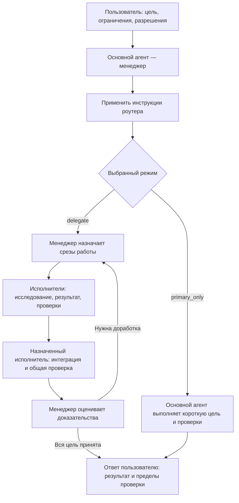
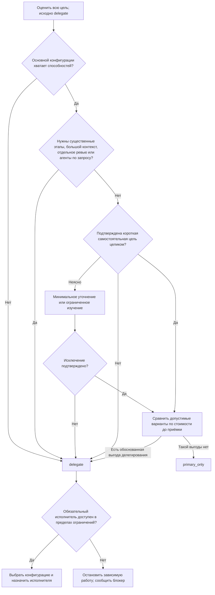
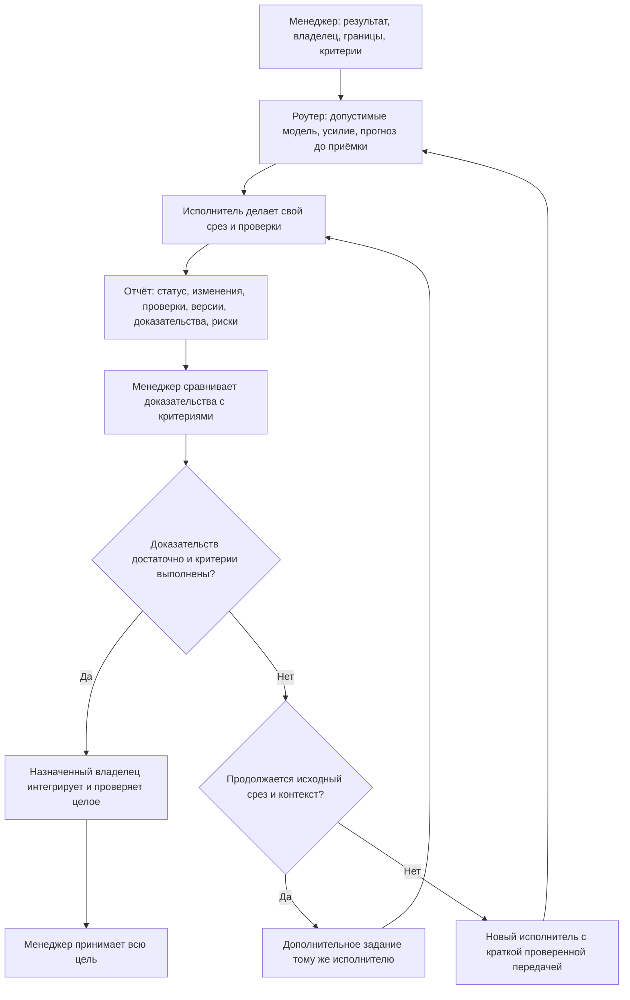
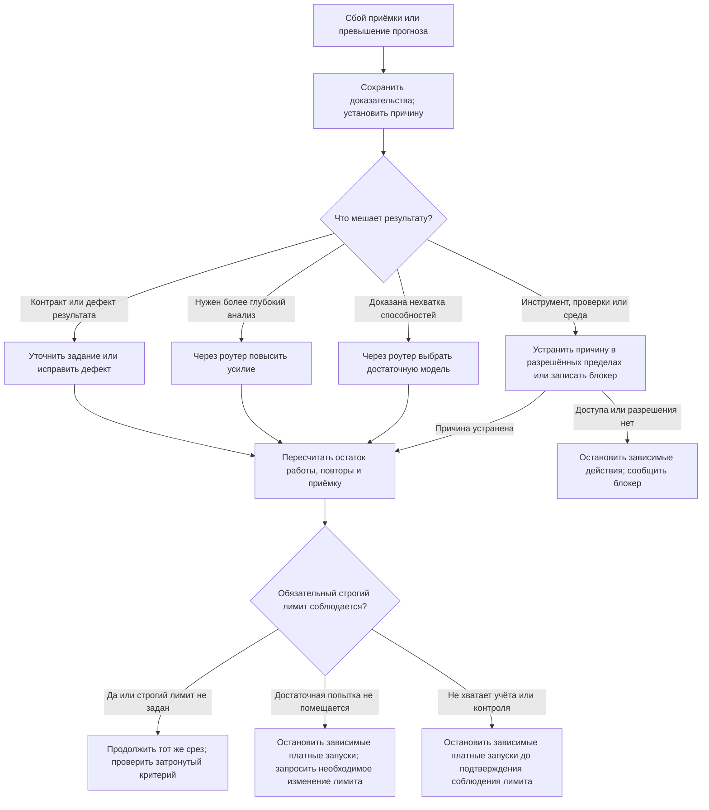

# Как работает менеджер субагентов

Основной агент руководит работой: определяет границы, назначает исполнителей, следит за качеством и принимает результат. В режиме `delegate` исполнители выполняют работу и интеграцию. Основной агент сохраняет ответственность за общие требования и завершение всей цели пользователя.

Это пояснение к текущим навыкам. При расхождении действуют [subagent-manager](../skills/subagent-manager/SKILL.md) и [task-model-router](../skills/task-model-router/SKILL.md). Схемы показывают предписанный порядок, а не гарантируют, что среда автоматически его выполнит. GitHub отображает блоки `mermaid` как диаграммы.

**Навык — набор инструкций, а не дополнительный агент.** Роутер помогает оценить задачу, модель, усилие и стоимость. Он не является постоянно работающей моделью или отдельным агентом. Для классификации задачи отдельного агента не запускают.

## 1. Кто за что отвечает

**Срез** — часть работы с одним понятным результатом и критериями приёмки. Один исполнитель может исследовать проблему, внести изменения и проверить их, если задание охватывает эти этапы. Для связанной цепочки этапов может хватить одного исполнителя. Отдельный агент на каждую команду не нужен. Дополнительные исполнители оправданы независимыми срезами, ресурсами и бюджетом.

Менеджер ставит дополнительные задания и координирует интеграцию. Он может точечно проверить конкретный пробел в доказательствах или противоречие. Это не разрешает повторять всё исследование исполнителя или выполнять вместо него производственную работу.

Источник: [режимы выполнения](../skills/subagent-manager/SKILL.md#execute-within-the-selected-mode), [назначения](../skills/subagent-manager/SKILL.md#give-assignments-in-delegate-mode), [общие ресурсы](../skills/subagent-manager/SKILL.md#control-shared-work).

## 2. Когда основной агент может выполнить работу сам

Режим выбирают для **всей текущей цели пользователя** до полного исследования. Исходный режим — `delegate`. Цена влияет на выбор только после проверки допустимости режима.

Для `primary_only` нужны достаточные способности основного агента, ограниченный контекст и отсутствие серии существенных этапов или другого обязательного делегирования. Обычное чтение, небольшая локальная правка и её точечная проверка могут составлять одну короткую цель. Длинная связанная цепочка остаётся делегируемой, даже если её удобно поручить одному исполнителю.

Маленький оставшийся шаг большой делегированной цели **не создаёт исключения**. Неопределённость также не разрешает основному агенту начать выполнение. Если исключение не подтверждено, сохраняют `delegate`.

Если обязательному исполнителю недоступны инструменты, слот, разрешения или допустимый бюджет, менеджер не подменяет его собой. Независимую разрешённую работу можно продолжить в границах выбранной роли. Неизвестную стоимость отмечают как неизвестную; её не считают нулевой и не обещают экономию.

Источник: [порядок выбора режима в роутере](../skills/task-model-router/SKILL.md#select-who-does-the-work), [условия исключения в менеджере](../skills/subagent-manager/SKILL.md#choose-the-execution-mode).

## 3. От задания к принятому результату

В задании закрепляют цель, стабильный ID среза, владельца, точные пути, разрешения, исключения и нужные источники. Указывают зависимости, проверяемые критерии, язык отчёта и способ передачи результата. У каждого файла, общего ресурса и проверки должен быть владелец.

Отчёт `done`, `partial` или `blocked` содержит результаты конкретных проверок и версии проверенных входов. Заявления «всё готово» недостаточно. Менеджер сверяет ограниченный объём фактических доказательств: например, diff, артефакт или результат команды. Проверку той же версии не повторяют без изменения входов, сбоя или названного пробела.

Повторно использовать исполнителя можно только для исходного среза с теми же границами, ролью, разрешениями, контрактом и назначением источников. Новая область, самостоятельный результат или независимое ревью требуют нового исполнителя. Ревьюер получает критерии и артефакты; вывод ему не задают. Независимое ревью нужно при существенном риске, спорном решении или явном запросе.

Источник: [состав задания](../skills/subagent-manager/SKILL.md#give-assignments-in-delegate-mode), [переиспользование исполнителя](../skills/subagent-manager/SKILL.md#reuse-within-the-original-slice), [приёмка и интеграция](../skills/subagent-manager/SKILL.md#accept-and-integrate).

## 4. Что делать после неудачной попытки

После двух неуспешных исправлений одного критерия прекращают слепые повторы и выясняют причину. Сбой инструмента, тестовой системы или среды сам по себе не доказывает слабость модели. Для следующей попытки сохраняют ожидаемый и фактический результаты, артефакты и сведения о прошлых попытках.

Если доказана нехватка способностей, можно пересмотреть рабочую оценку и объём повторов, повысить модель или усилие в пределах текущих разрешений. Низкая начальная оценка не обязывает повторять недостаточную конфигурацию. Пересмотр прогноза сам по себе не требует нового согласия пользователя. При этом нельзя повышать ресурсы без ограничения или автоматически выбирать самую дорогую модель.

**Строгий лимит пользователя остаётся обязательным.** До платного запуска нужны учёт и контроль, достаточные для соблюдения этого лимита всей командой. Если их не хватает, зависимые платные запуски останавливают до подтверждения соблюдения лимита. Повышение лимита не устраняет этот пробел. Если достаточная попытка не помещается в лимит, запрашивают только необходимое изменение. Числовой прогноз сам по себе не обеспечивает соблюдение лимита. При смене модели или усилия, которую инструмент не поддерживает для продолжения агента, запускают нового исполнителя того же среза с проверенной передачей.

Источник: [разбор неудач менеджером](../skills/subagent-manager/SKILL.md#accept-and-integrate), [прогноз перед запуском](../skills/task-model-router/SKILL.md#use-the-forecast-before-each-start), [повторный выбор конфигурации](../skills/task-model-router/SKILL.md#accept-and-reselect).

## Какие навыки подключать по необходимости

| Ситуация | Навык и граница |
| --- | --- |
| Нужны зависимости, исполнители, границы контекста и точка возобновления | [plan-agent-work](../skills/plan-agent-work/SKILL.md#select-the-mode-first). Карта исполнителей входит в план; запрос только плана не разрешает запуск реализации и её проверок. |
| Нетривиальный выбор внутри уже разрешённой работы | [autonomous-decision-agent](../skills/autonomous-decision-agent/SKILL.md#route-the-question). Совет исполнителя с правом чтения через существующего менеджера; не заменяет согласие пользователя. |
| Повторяются сбои или нужно проверить связанные причины | [root-cause-audit](../skills/root-cause-audit/SKILL.md#scope-and-permission). Аудит устанавливает причины и пределы доказательств; сам по себе не разрешает исправления. |
| Крупная задача завершена или запрошен разбор расхода | [task-token-retrospective](../skills/task-token-retrospective/SKILL.md#use-the-available-evidence). Краткий разбор по имеющимся данным; без выдуманных счётчиков и обещаний экономии. |

Эти навыки не требуют загрузки всех инструкций сразу и не создают дополнительный слой менеджеров. Их отдельные режимы не отменяют выбранный режим выполнения общей цели. Разрешения пользователя, режим «только план», ограничения среды и обязательные согласования сохраняются на всех этапах.
